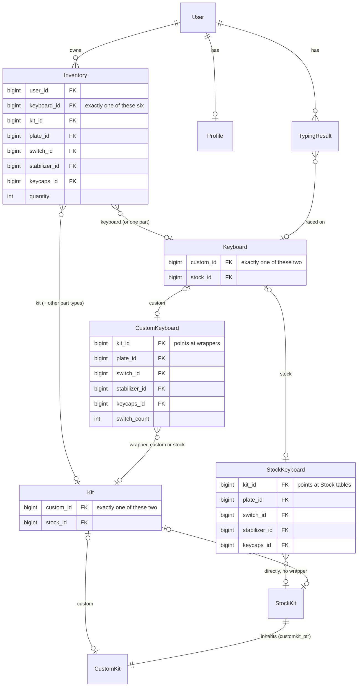

# Data model
Every part can be either custom (typed in by a user) or stock (shared catalog data), and a user's inventory can hold any type of part or a whole keyboard, which can be made of any combination of custom and stock parts. 

Generic FK/ContentType made the schema beyond nasty ([good post on why](https://lukeplant.me.uk/blog/posts/avoid-django-genericforeignkey/)). Instead, the data model uses nullable FKs and check constraints to achieve a similar result.

#### Table diagram
Each part type has the same three tables. Only kit is drawn here, but switch, plate, stabilizer, and keycaps all look the same.

#### Structure
- Top level is `Inventory`, which is one row per physical thing a user has. Exactly one of its six FKs is set (`inventory_data_exists`). `keyboard` set means a board, anything else is a standalone part with a `quantity`
- Next level down is the wrapper models (`Keyboard`, `Kit`, `Plate`, `Switch`, `Stabilizer`, `Keycaps`), where exactly one of `custom`/`stock` is set (`<name>_data_exists`). Use `.obj` to get whichever instance of CustomX or StockX it is
- Last, the base layer tables (`CustomKit`, `StockKit`, etc) have the actual data. Calling `Inventory.obj` always gets you the instance from the base layer tables.

#### Oddities
- Always prefer going through manager methods rather than calling the ORM directly on models, since they generally cover the weird cases below
  - If a new weird case comes up that isn't covered by a manager method, one should be written
- A board made of parts is one `Inventory` row, not one row per part on the board. Moving a part onto a board takes it out of the standalone row, and taking it off can put it back on its own
- `CustomKeyboard` points at wrappers since it can mix custom and stock parts, but `StockKeyboard` skips the wrappers and points straight at `Stock*` tables. 
  - `part_obj()` in `managers.py` handles both without needing to worry about it 
- `.stock` can mean two different things - on a wrapper it's the FK to the base StockX model if it exists, on the base model it's a class attribute that's `True` or `False`
- Stock wrappers are shared, so there's one `Kit` per `StockKit` for all users, which always made with `get_or_create(stock=...)`. Never edit a stock wrapper as if it belongs to one user
- Custom wrappers can be shared too, between a board and the leftover standalone row when part of a set went onto the board. `part_in_use()` checks for this, and editing a part that's in use somewhere else gives the board its own copy
- Inventory's FKs are `SET_NULL`, but nulling the only one set would break the check constraint. Deleting a wrapper directly with an inventory row still on it will fail, so go through the managers, which move or delete the row first

#### Moving between custom and stock
- Promote a part from custom to stock (`CatalogManager.promote_part`) - copies the custom data to a new stock row, repoints the wrapper, and deletes the custom row
- Delete a stock part (`delete_stock_part`) - everyone with a copy of it in their inventory somewhere gets their own custom copy first, prebuilts with the part included lose the part
- Delete a prebuilt (`delete_stock_keyboard`) - each owner's `Inventory` row gets repointed at a new `CustomKeyboard` with the same parts
- Edit a prebuilt you own (`KeyboardManager.edit_keyboard`) - your inventory row moves to a new custom build, and the prebuilt stays in the catalog
